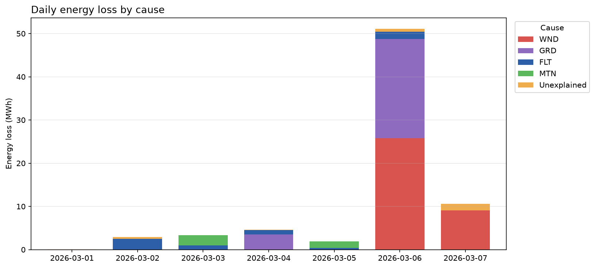

# AlphaWind performance analysis
Period: 2026-03-01 – 2026-03-07, 6 turbines

## Summary
During the week, AlphaWind produced **642.3 MWh**. Given the wind conditions, it could have produced
**719.8 MWh**, so **77.5 MWh (10.8%)** was not produced. Of this, **74.5 MWh (10.3%)** can be linked to
a specific cause; the remaining 3.0 MWh is due to small daily differences between actual and expected 
energy production.

Most of the lost energy (**84%**) was caused by factors outside the park's control: turbines
switching off in very strong wind (**49%**) and limits set by the electricity grid (**36%**).
Turbine faults and planned maintenance caused **14%**, and only **2%** has no recorded explanation.

One turbine, **T04, produces about 9% less than expected even when it is running normally**.
The stop records are also incomplete: some park-wide stops were not recorded for every turbine.

## Key actions
1. **Inspect T04** (7.9 MWh lost because it produces less than expected). Its records list the last
   service 120 days ago, although it also had a 3-hour maintenance stop this week.
2. **Improve stop records**: record park-wide stops for every turbine, always record when a stop
   ends, and record short stops too (a 10-minute strong-wind shutdown on 7 March was not recorded).

## Energy loss breakdown

| Cause | Estimated energy loss (kWh) | % of total loss |
|---|---:|---:|
| Extreme wind conditions (WND) | 36,360 | 48.8 |
| Grid limitation (GRD) | 26,518 | 35.6 |
| Technical faults (FLT) | 6,547 | 8.8 |
| Scheduled maintenance (MTN) | 3,864 | 5.2 |
| Unexplained | 1,199 | 1.6 |
| **Total** | **74,488** | **100** |

*Daily energy loss by cause.*

**How the losses were estimated.** First, I estimated how much a turbine normally produces at each
wind speed, using periods when the turbines were working normally. This estimate matches normal
production within about 1%. Then, for every turbine and every 10 minutes, I compared actual
production with this expected value. Any shortfall is assigned to **one cause only**: the stop
recorded at that time, or "Unexplained" if production was clearly too low and no stop was recorded.
Because each 10-minute period is counted once, no loss is counted twice.

**Strong-wind stops.** Turbines switch off automatically for safety when the wind is above about
25 m/s, so these losses can't be avoided. They are included to show how much energy the park could
not produce in those conditions. The useful question is whether turbines stayed off longer than needed.

## Turbine overview

| Turbine | Time available | Output while running (vs expected) | Main issue | Last service |
|---|---:|---:|---|---:|
| T01 | 92.9 % | 101.6 % | Fault stop (2 h) | 12 days |
| T02 | 93.2 % | 99.4 % | Fault stop (1.5 h); grid stop on 6 March not recorded, corrected | 40 days |
| T03 | 93.2 % | 101.8 % | Fault stop (1.5 h) | 5 days |
| T04 | **89.7 %** | **91.2 %** | Lower output while running; most fault time (3 stops, 4.5 h); maintenance (3 h) | **120 days** |
| T05 | 93.2 % | 102.0 % | Reduced output on 6 March before a hydraulic fault (1.5 h) | 18 days |
| T06 | 92.4 % | 98.4 % | Maintenance (3 h); grid stop on 6 March not recorded, corrected | 65 days |

*"Time available" is the share of the week a turbine was not stopped. It includes park-wide stops
(strong wind 3.8 h, grid limits 6.0 h), which affected all turbines equally; the differences between
turbines come from faults and maintenance.*

- **T04** produced about 9% less than expected while running normally; the other turbines were
  within ±2%. It also had the most fault stops (3 stops, 4.5 h) and a 3-hour maintenance stop.
  The reason is unclear: it could be a technical problem, or T04 may simply get less wind at its
  location, since wind is measured at only one point for the whole park.
- **T05** produced only 72–75% of its expected output on 6 March between 12:40 and 13:50, with no
  stop recorded (399 kWh lost). Later that day it stopped with a hydraulic fault (19:30–21:00).
  The reduced output may have been an early warning sign of that fault.

## Data quality
The stop records could not be used as they were. I corrected them by comparing with other
turbines' records, wind speed and production:
- **Park-wide stops missing for some turbines**: the grid limitation on 6 March was not recorded
  for T02 (08:10–10:10) and T06 (21:30–23:30, when the whole park was limited to about 25% of its
  expected output). Added.
- **One strong-wind stop not recorded for any turbine**: 7 March 08:20–08:30 (wind 25.2 m/s, all
  turbines produced nothing). Added.
- **4 stops had no end time**; filled in from the same stop on other turbines.
- **1 duplicate record** removed.
- **Maintenance and service records don't match**: T04 and T06 had 3-hour maintenance stops this
  week, but the turbine information lists their last service as 120 and 65 days ago. Either this
  maintenance was not a full service, or the service dates were not updated.

These corrections moved **3368 kWh** from "Unexplained" to a known cause: **1853 kWh** to grid
limitation and **1515 kWh** to strong wind. The total loss did not change, which shows the
corrections only moved losses between causes. Of the remaining **1199 kWh** without an
explanation, 399 kWh is T05's reduced output on 6 March; the rest is short periods of slightly
reduced production.

## Assumptions and limitations
- Expected production is based on only 7 days of data and on one wind measurement for the whole
  park, so differences in wind between turbine locations are not taken into account. Its ~1%
  accuracy was checked on the same data it was built from, so it may be slightly optimistic.
- At very low wind (below about 3 m/s), turbines are expected to produce nothing. Above 25 m/s,
  they are expected to produce their maximum output (about 250 kWh per 10 minutes), so every
  strong-wind stop counts as a full loss.
- A 10-minute period counts as part of a stop if the stop covers any part of it.
- When no stop is recorded, a 10-minute period only counts as a loss if production is below 85% of
  expected and at least 7.5 kWh lower. This avoids counting small, normal variations. Using 80% or
  90% instead changes the total loss by less than 3% and doesn't change which causes are largest.
- Missing stops and end times were filled in from other turbines, wind and production, so the real
  times may differ slightly.
- "Days since last service" is a single current figure and doesn't match this week's maintenance
  records. With only six turbines, any link between time since service and performance is an
  observation, not proof.

## TODO (in priority order)
1. **Look into T04 and T05 with more detailed turbine data** (alarm records and wind measured at
   each turbine, which were not provided). These are the losses the maintenance team can actually
   fix. The data would show whether T04's lower output is a technical problem or due to its
   location, and whether T05's reduced output was linked to its hydraulic fault.
2. **Check whether strong-wind stops lasted too long**: compare each stop's length with the wind
   speed to see how long turbines stayed off after the wind dropped. Strong-wind stops are the
   largest loss, and this number depends most on how long the stops were recorded.
3. **Confirm service records**: find out why T04 and T06 had maintenance this week but their last
   service is listed as 65–120 days ago. This decides whether time since service really explains
   T04's lower output.
4. **Improve the expected-production estimate**: rebuild it with the corrected stop records,
   separately for each turbine and with more than a week of data. This would make all loss
   estimates more precise, especially T04's.